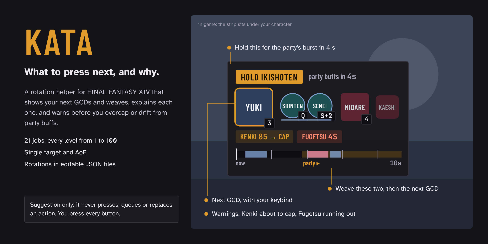

# Kata: release builds

Kata is a suggestion-only rotation helper for FINAL FANTASY XIV (Dalamud plugin). It shows what to press next and why.
It never presses, queues or replaces actions, never edits hotbars and never changes your target.

This repository only holds the release zips and `repo.json` for Dalamud. The source is not here.

## Install (once)

1. In game, type `/xlsettings` and open the **Experimental** tab.
2. Under **Custom Plugin Repositories**, paste this link, click **+**, tick it as enabled, then **Save and Close**:

   `https://raw.githubusercontent.com/Gompex/kata-releases/main/repo.json`

3. Type `/xlplugins`, open **All Plugins**, search for **Kata** and click **Install**.
4. Type `/kata` to open it.

New versions arrive like any other plugin update.

Current version: **0.5.19.0** - 0.5.19: MP is checked for every job